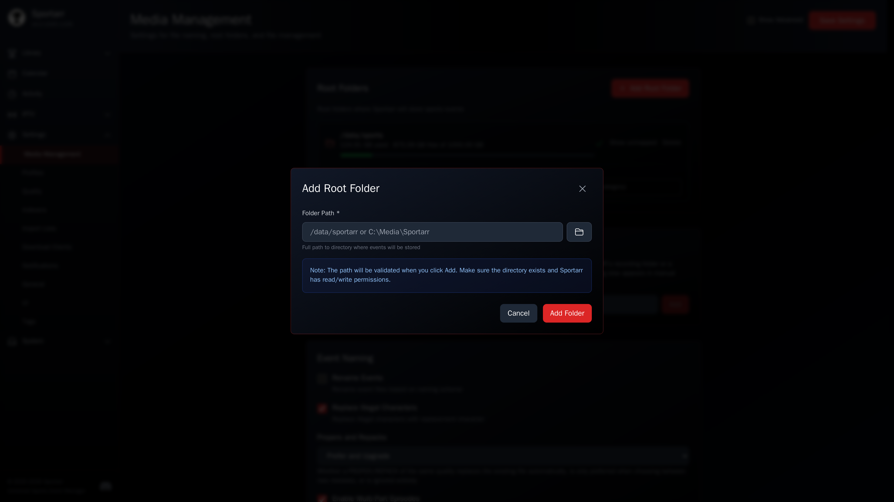
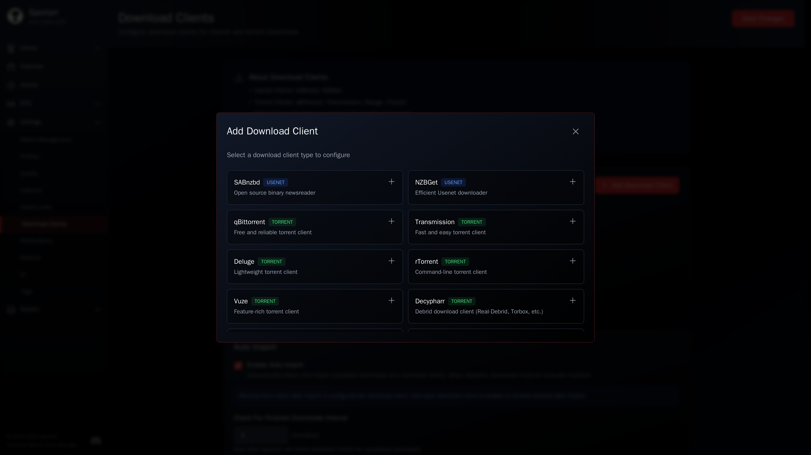
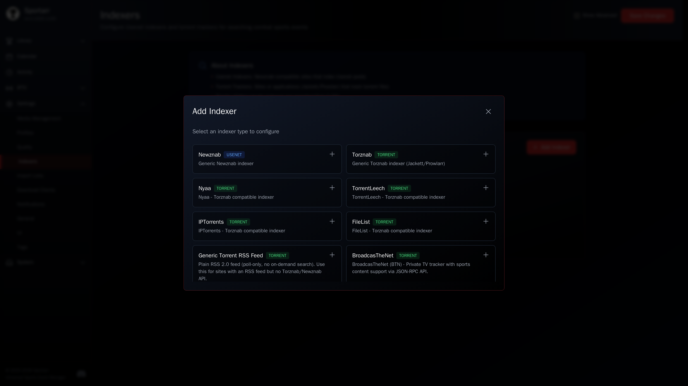
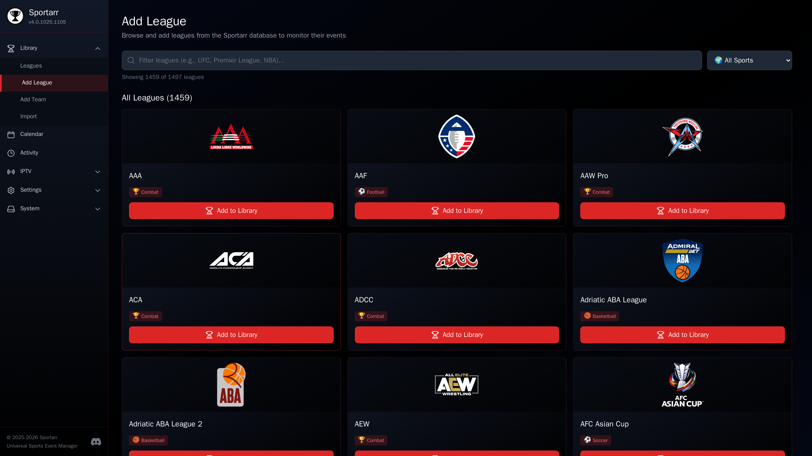
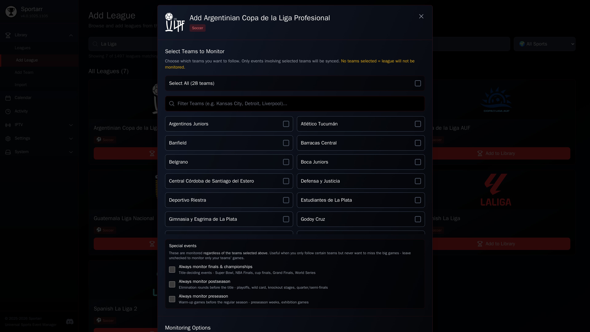
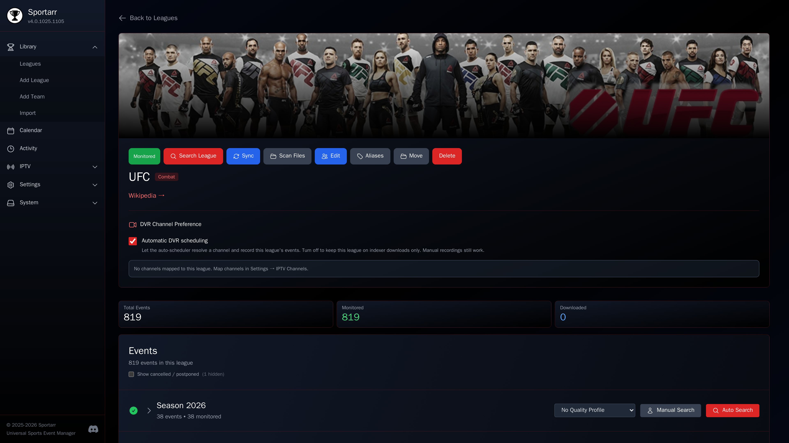

# Initial Setup

The setup guide walks a new install through the library, release preferences, download source, and playback. You can also use the settings pages below.

## Release preferences in the setup guide

Sportarr includes ready-to-use 1080p and 4K quality profiles. The 1080p profile is the initial default. You can change the default later under **Settings > Profiles**.

In **Settings > Profiles**, **Upgrade Until** accepts a quality or a quality group. Qualities in the same group share a rank. Under **Settings > Media Management**, **Propers and Repacks** decides whether a newer revision takes priority over custom format score at that rank. Choose **Do Not Prefer** if the higher score should decide.

To use different release preferences for a league, open **Settings > Profiles** and choose **Clone Profile** on an existing profile. Rename the copy, change its custom format scores, and save it. The copy keeps its own scores and does not follow automatic score sync, even if the original profile does. Open the league and choose the copy from its profile dropdown. Other leagues keep their assigned profiles and scores.

**Upgrade Until Custom Format Score** is a separate target. Leave it empty to stop score-based upgrades when the existing file reaches the quality cutoff. Set it to keep accepting higher scoring releases at the same quality until the existing file reaches that score. The release must also meet **Minimum Score Increment**. A higher quality tier does not bypass a reached quality cutoff.

Choose **Standard setup** to start with the built-in profiles and neutral custom format scores. Choose **Recommended setup** to import custom format scores and quality size limits from TRaSH Guides. Recommended setup needs an internet connection. If the import fails, your current release preferences stay in place so you can try again.

On a new install, **Skip Step** keeps Standard setup. Reopening the guide and skipping this step does not change existing preferences. Switching from Recommended to Standard clears scores in unedited built-in profiles. Choosing Standard when it is already active leaves scores alone. Custom profiles and previously imported quality size limits are left alone.

On a new install, the file naming dropdown starts with a detailed preset. Saving the step applies that preset and turns on **Rename Events**. Choose **Keep current naming** or **Skip Step** to leave naming unchanged. A reopened guide starts with **Keep current naming**, so saving it does not change existing settings unless you select a preset. TV libraries need season and episode numbers to recognize events as episodes. The `{Sportarr Id}` token then gives the Sportarr Metadata Agent an exact event key. Keep both for the most reliable matching. The guide warns when a selected format omits either one.

## Manual setup

Four steps take a fresh install to a working library.

## 1. Root folder

Go to **Settings > Media Management** and add a root folder. This is where Sportarr stores your sports library.

## 2. Download client

**Settings > Download Clients**. Add your download client: qBittorrent, Transmission, Deluge, rTorrent, Vuze, Aria2, Synology Download Station, SABnzbd, NZBGet, NZBdav, Decypharr, or a torrent/usenet blackhole folder.

!!! tip "Docker path alignment"
    If both apps run in Docker, make sure the download path is visible to both containers at the same path. When paths differ between hosts, set up a remote path mapping in Sportarr.

## 3. Indexers

**Settings > Indexers**. Add your Usenet indexers or torrent trackers. Sportarr supports Newznab and Torznab APIs, so [Prowlarr integration](../integrations/prowlarr.md) works out of the box.

For a local HTTPS indexer with a self-signed certificate, open its advanced settings and turn on **Disable certificate validation**. This works only with a literal address in `10.0.0.0/8`, `172.16.0.0/12`, or `192.168.0.0/16`. A hostname does not qualify, even if it resolves to one of those addresses. Keep the option off for public indexers. If qBittorrent also connects over HTTPS, its **Settings > Download Clients > qBittorrent > Use SSL > Disable SSL Certificate Validation** option covers `.torrent` links it fetches from the indexer. The indexer option alone does not cover that fetch.

For a local HTTPS service addressed by hostname, turn on advanced settings and use **Settings > General > Certificate Validation > Disabled For Local Addresses**. This applies to outgoing connections, including download clients. Sportarr accepts an invalid certificate only when every address for the hostname and the connected peer are local. Loopback connections are allowed in every mode. **Disabled** accepts invalid certificates from public services too.

## 4. Add content

Use the search to find leagues or events. Add them to your library and Sportarr starts monitoring.

Sportarr uses the league's competition format from the API to decide whether to show team selection. Team competitions let you choose which teams to follow. Individual event leagues, such as Diamond League athletics, use your event monitoring settings without a team filter, even when the source lists countries or federations as teams.

If an existing individual league is missing events because of saved team selections, use **More > Sync > Deep Sync** on its league page after updating. This refreshes its competition format and imports the missing historical events.

